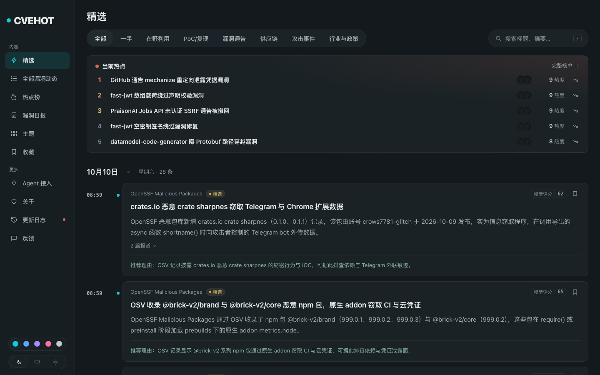
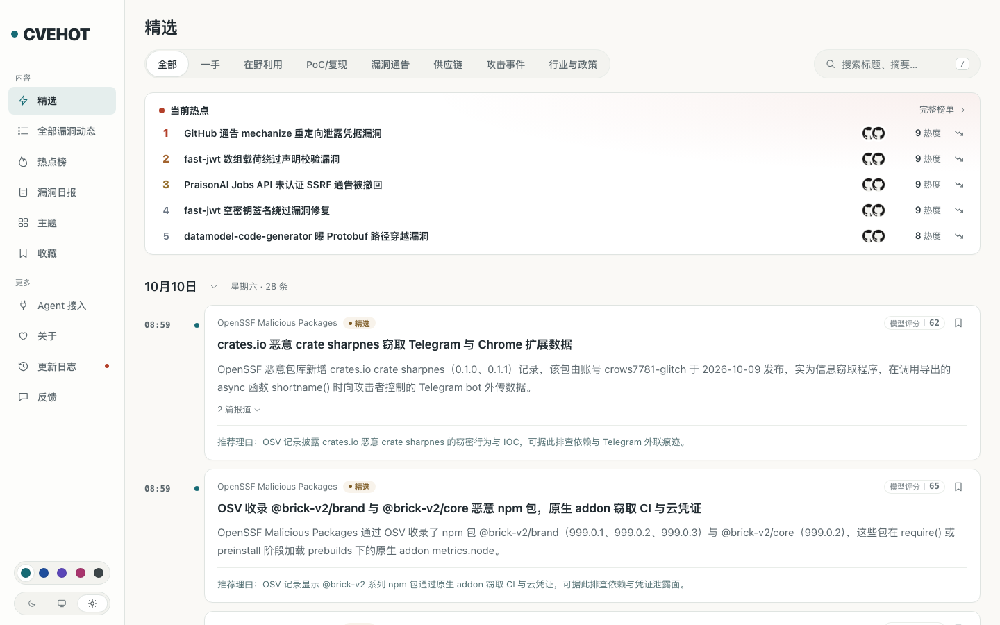
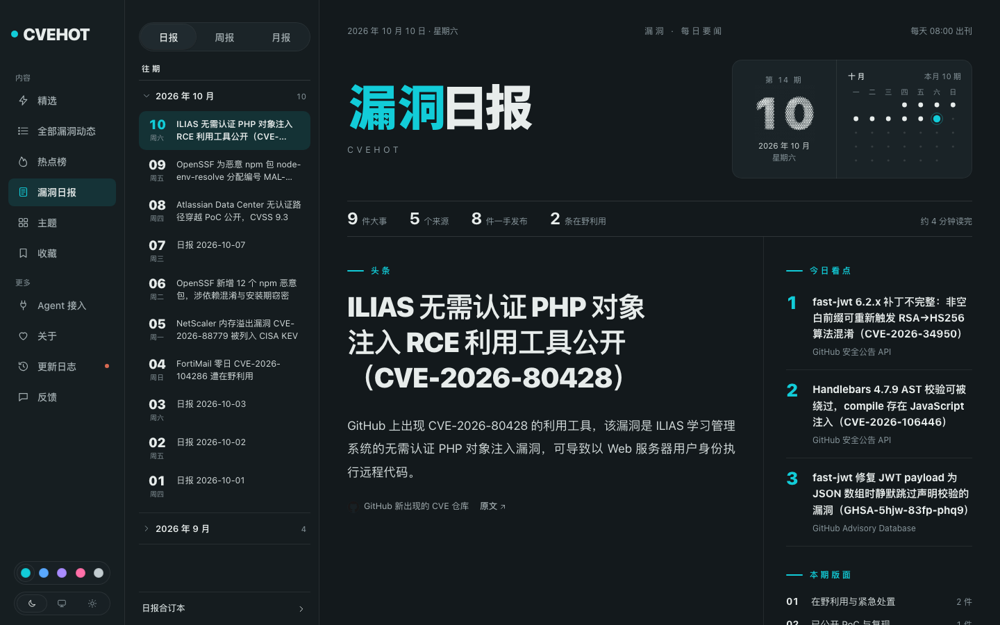
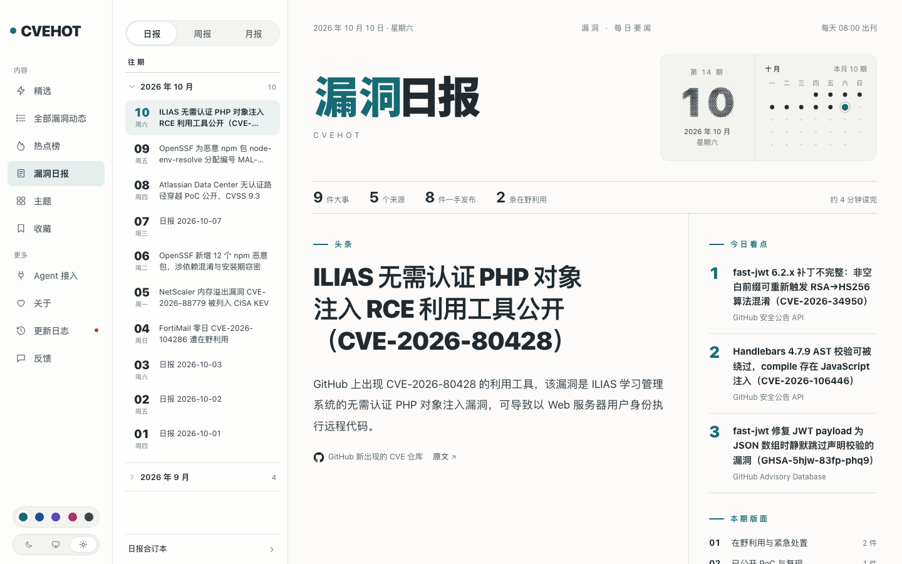
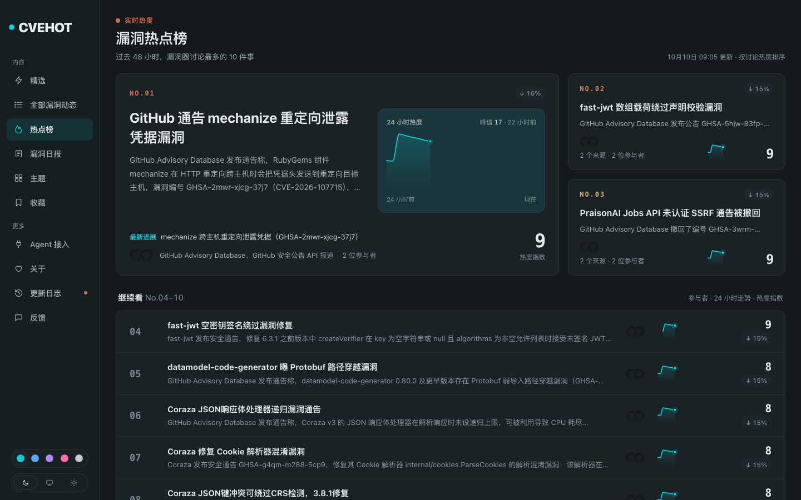
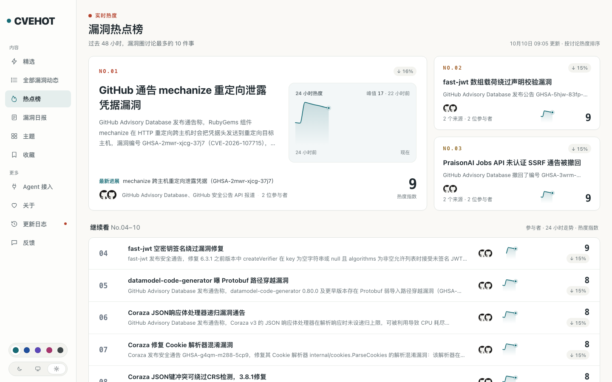

<p align="center">
  
</p>

<h1 align="center">CVEHOT</h1>

<p align="center">
  Watches new vulnerabilities, groups every source reporting the same one into a single event, and
  publishes a daily brief.
</p>

<p align="center">
  <a href="README.md">简体中文</a> · <b>English</b>
</p>

<br>

## What this is

This is a modified version of [AIHOT](https://github.com/KKKKhazix/AIHOT), an open-source engine by
[@KKKKhazix](https://github.com/KKKKhazix) (数字生命卡兹克). The engine here is upstream's; the
industry was changed from AI news to vulnerability intelligence.

Sources are the GitHub Security Advisories, cvelistV5, CISA KEV, the OpenSSF malicious-packages
dataset, and new CVE repositories on GitHub. New vulnerabilities and incidents get a headline and a
summary, are grouped under their CVE identifier, ranked by heat, and compiled into a daily report.

- Upstream: <https://github.com/KKKKhazix/AIHOT>
- License: MIT, © 2026 数字生命卡兹克, see [LICENSE](LICENSE)
- This repository's documentation is under [`docs/`](docs/); the engine's full documentation lives upstream
- Per upstream [NOTICE](NOTICE), the AIHOT name and logo are not covered by the MIT license, so this
  repository uses its own name and icons

## Screenshots

Shot in both themes. The switch sits at the foot of the sidebar on the desktop and on the 我的 page on a
phone; a second row there picks the accent colour.

| Dark | Light |
| --- | --- |
|  |  |

| Dark | Light |
| --- | --- |
|  |  |

| Dark | Light |
| --- | --- |
|  |  |

## What changed

Only the industry pack. The engine is upstream's.

- `industry/sources.json`: seven vulnerability sources, plus a self-hosted push source `gh-poc-scan`
- `industry/taxonomy.ts`: categories rebuilt around exploit-in-the-wild, public PoC, vendor advisories and supply-chain poisoning
- `industry/topics.json`: topics are vendors, components and vulnerability types
- `industry/prompts/`: scoring and fact extraction rewritten for vulnerabilities
- `industry/selection.ts`: selection thresholds retuned for vulnerability intelligence
- `site/site.ts`: site name, wording, home and about copy
- `site/brand/`: own icons
- `modules/cve-repo-index/`: scans GitHub for repositories mentioning CVEs and builds an index, serves as a heat signal source for weighting and displays "N PoC repositories" on story pages
- the four judging steps (filtering, scoring, grouping, group review) can be handed to [Jev](https://openrouter.ai/~typesafe/jev-latest), which returns typed answers and probabilities rather than text; without a key they keep using the default model

## Credit

`modules/cve-repo-index/` follows [unSafe.sh's CVE page](https://unsafe.sh/cve), which collects GitHub repositories mentioning a CVE in bulk and can therefore answer how many PoCs exist for a given identifier.

This project's existing mechanism only looks at repositories created in the last few days, with no historical depth. This module now covers both:
- **Historical index** — scans GitHub sliced by month, stores results in its own `cve_repos` table; a lookup by identifier returns a definite number, nothing feeds selection, grouping or the daily report, zero model calls
- **Heat signal** — receives newly created PoC repositories as a push source, weights them into heat calculations, and displays the total repository count for a CVE on story pages

The GitHub search API returns at most 1000 results per query, and slicing by month still truncates busy months. So besides time-sliced backfill there is `--lookup <CVE> --live`, which asks GitHub directly for a single identifier's authoritative count.

The commands all run inside the container.

```bash
# Look it up locally and ask GitHub for the authoritative count as well
docker compose exec -T worker node scripts/cve-repo-index.ts --lookup CVE-2026-21589 --live

# Local index only: first-seen date and stars, no network
docker compose exec -T worker node scripts/cve-repo-index.ts --lookup CVE-2026-21589

# Coverage
docker compose exec -T worker node scripts/cve-repo-index.ts --stats

# Backfill history, sliced by month
docker compose exec -T worker node scripts/cve-repo-index.ts --backfill --from-year 2024 --pages 3
```

The daily increment needs no attention; the engine's scheduler runs it at 05:20 (see `modules/cve-repo-index/server.ts`).

## Run it

Needs Docker and Node.js 24, plus an OpenAI-compatible model API key.

```bash
git clone https://github.com/zseeu1/CVEHOT.git
cd CVEHOT
node scripts/init-env.ts --llm-key <your model API key>
docker compose up -d --build
```

Open <http://localhost:3000>. Admin is at `/admin`; the password is `ADMIN_PASSWORD` in `.env`.

### Set up GITHUB_TOKEN

A few sources use the GitHub API (security advisories, CVE repository index). Unauthenticated search allows 10 requests per minute; a token keeps them steady and makes backfilling the CVE index much faster.

1. Open <https://github.com/settings/tokens/new>
2. Any note will do, pick an expiration, tick **`public_repo`** (read access is all that is needed)
3. Click **Generate token** at the bottom and copy the `ghp_...` string
4. Add a line to the project's `.env`: `GITHUB_TOKEN=ghp_...`
5. Restart: `docker compose up -d`

### Optional: run the judging steps on Jev

The four steps that judge rather than write (filtering, scoring, grouping and group review) can be handed to [Jev](https://openrouter.ai/~typesafe/jev-latest), TypeSafe's System One model. It reads the whole item once and returns a handful of typed answers with probabilities, and writes nothing.

Add to `.env`:

```bash
JEV_BASE_URL=https://openrouter.ai/api
JEV_API_KEY=sk-or-v1-...

PREFILTER_MODEL=jev
SCORE_MODEL=jev
```

The same goes for `GROUP_MODEL` and `GROUP_REVIEW_MODEL`. Without `JEV_API_KEY` these steps keep using the default model, and nothing else changes.

> **Region restriction**: Jev admits requests by egress region. Deployments whose egress sits in a restricted region get a 403 and the four judging steps stop; the writing steps are unaffected.

See [docs/deploy.md](docs/deploy.md) for deployment, domains and HTTPS.

## Upstream

The engine comes from [AIHOT](https://github.com/KKKKhazix/AIHOT), by
[@KKKKhazix](https://github.com/KKKKhazix). Engine issues belong upstream; the industry changes in
this repository are mine.

To pull upstream updates, add the remote once.

```bash
git remote add upstream https://github.com/KKKKhazix/AIHOT.git
git fetch upstream && git merge upstream/main
```

## License

MIT, see [LICENSE](LICENSE). The AIHOT name and logo are not covered by it, see [NOTICE](NOTICE).
